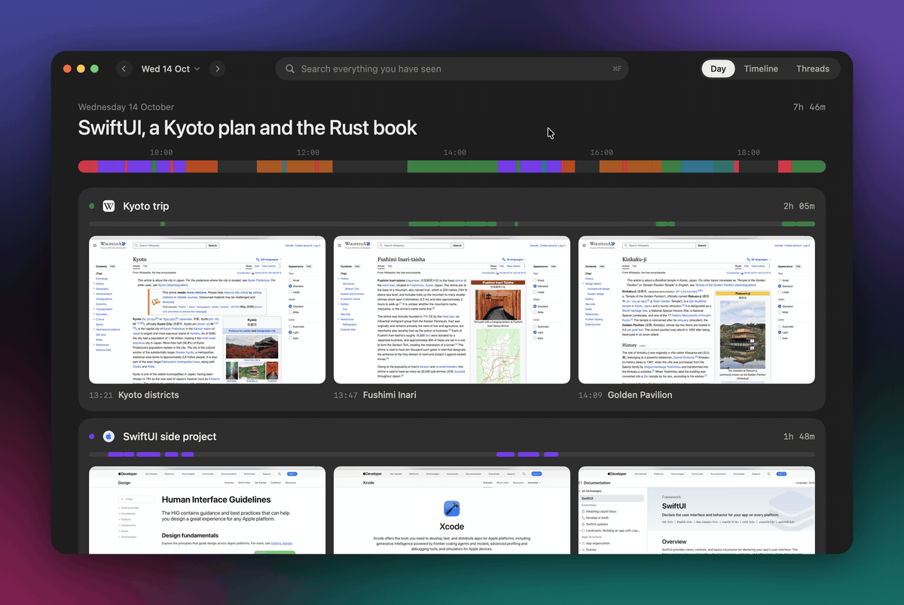
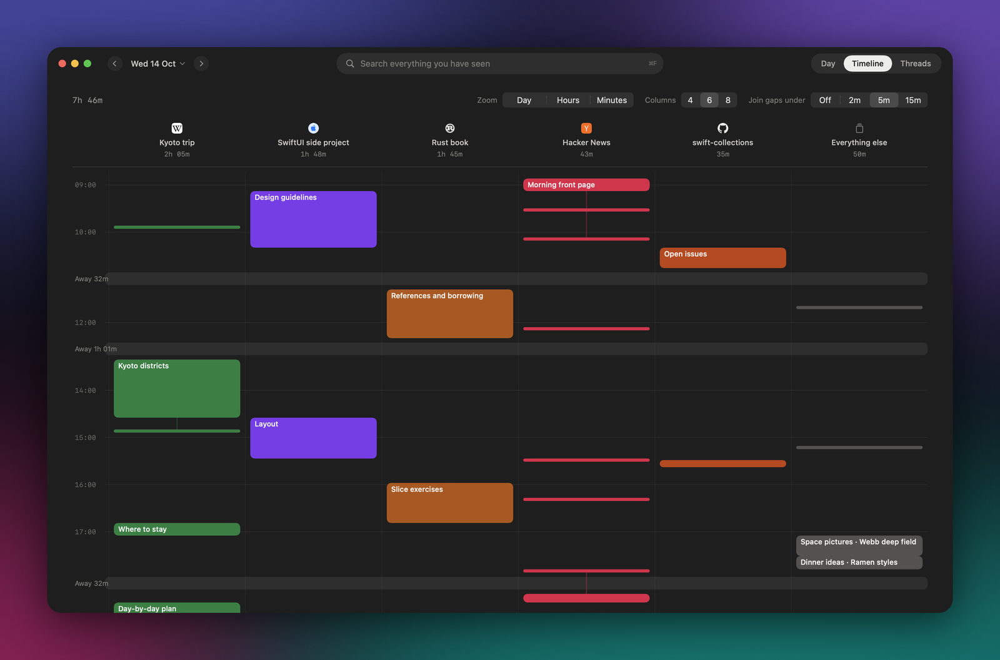
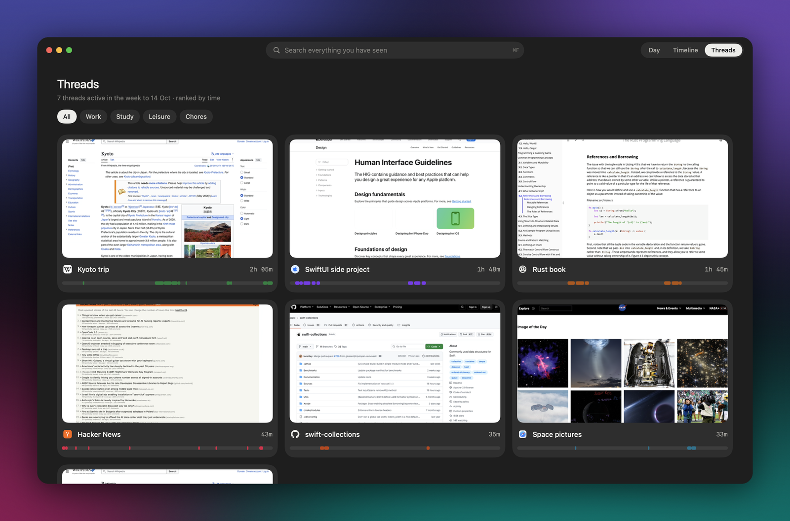
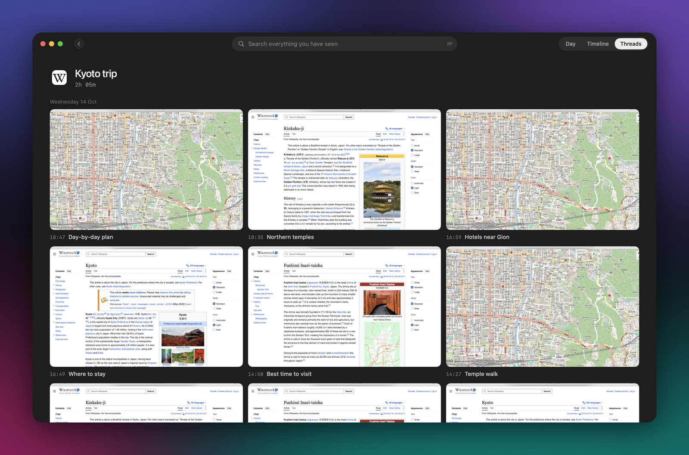
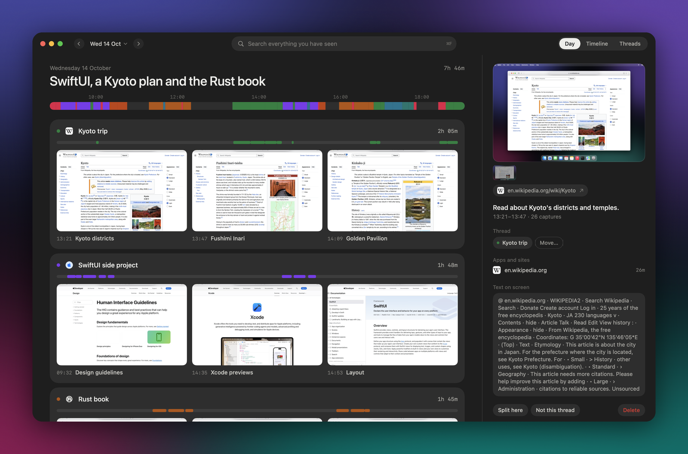
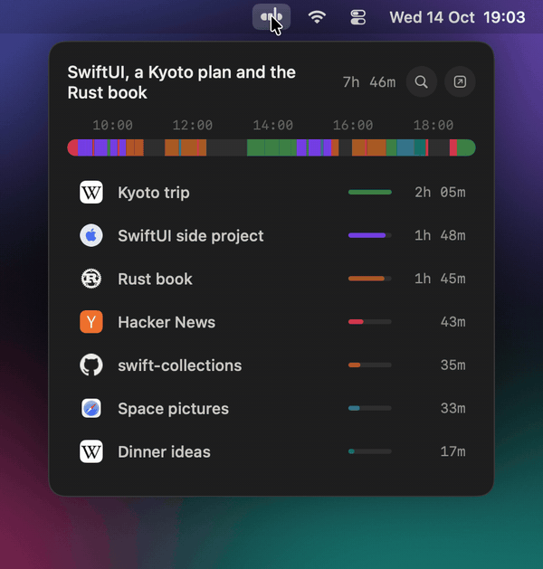
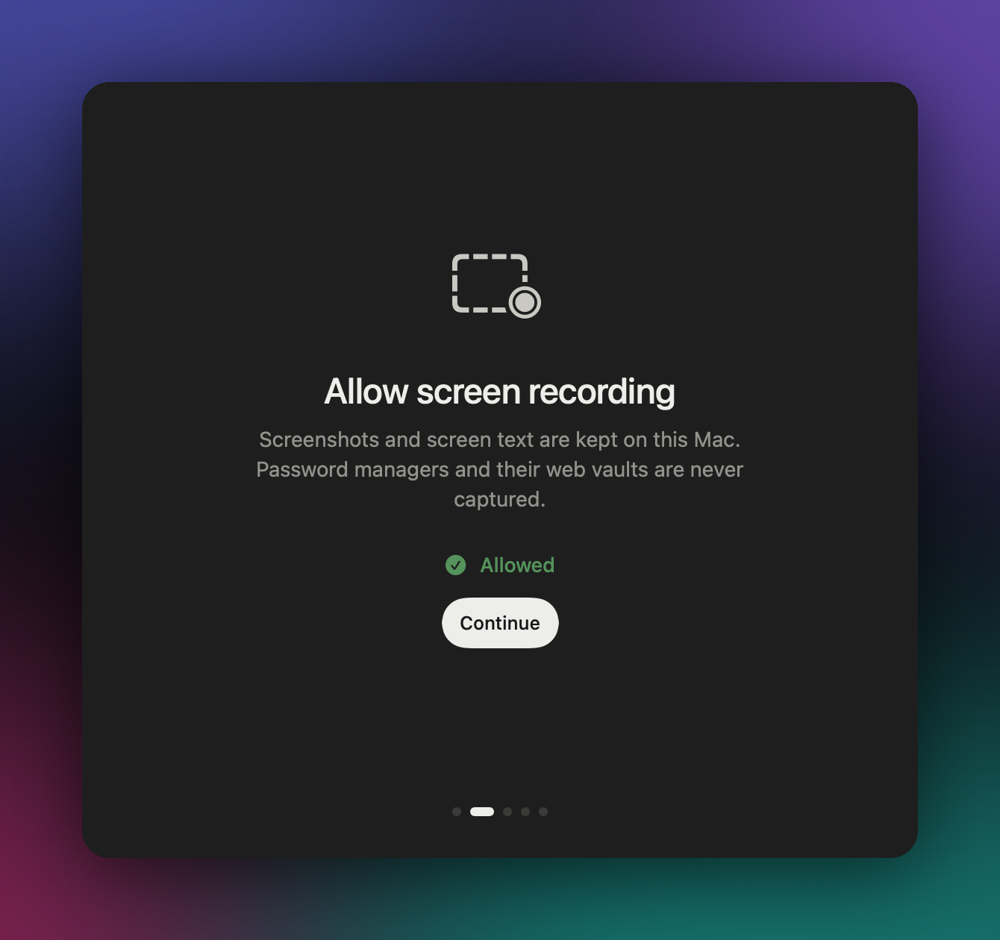

# Screencap

Screencap is a lightweight, macOS-native activity memory for you and your agents, built on [smart capture](#how-it-works) and [System-1 models](https://arxiv.org/abs/2502.12470). It sorts your day into the threads of your work, finds anything you saw, and with ⌥Space [puts you back](#back-to-where-you-were) in any thread you left. It runs in the background on under 1% of one CPU core and about 30 MB of memory.

**[Download the latest release](../../releases/latest)** · macOS 26 on Apple Silicon



## Your day in 3 ways

**Day** sums up the day in a few words and lays it out as one strip, coloured by thread: the piece of work, chore or pastime each stretch belongs to, which you may come back to over days. Move the pointer along the strip to see what was on screen at any point. Below the strip, each of the day's threads shows its key moments. A moment is one stretch of work on one thing, shown by its best screenshot and a short title.

**Timeline** gives each thread its own column, with time running down the page, so work you kept going in parallel sits side by side.



**Threads** shows every thread of the past week with a cover picture, the time it took and when in the day it happened. If Screencap grouped something wrong, rename or merge a thread from its right-click menu.



Click a thread to see all its moments, day by day, newest first.



## Find anything you saw

The search box at the top of the window finds moments by any word that was on screen. Click a moment to see its screenshots, the text on screen and the page or app it was in; one more click opens that page or app again. From there you can move the moment to another thread or delete it.



## Back to where you were

Screencap sorts your day into threads, the pieces of work you keep coming back to. Coming back to one usually means finding everything it had open again: the Claude Code session in Claude's sidebar, the page among your tabs, the terminal under another window. Resume does that for you. Press ⌥Space in any app, choose a thread and press Return; the thread you were in before is already chosen. Resume selects the session and the page and raises the windows, leaving each where it is.

![A made-up afternoon on a Mac. You fix a bug in three places, a Claude session, a pull request and a terminal, then switch to planning a trip in the same windows. Later, getting the bug fix back without Screencap takes seven steps: the session in Claude's sidebar, the pull request among the tabs, and the terminal under Notes through Mission Control. With Screencap, ⌥Space opens the Resume palette, Tab shows the three places the bug fix had open, and Return brings them back. The trip comes back the same way](docs/readme/resume.gif)

| Key | In the palette |
|---|---|
| ↑ ↓, or type | Choose a thread; the preview shows its screen as you left it |
| Return | Bring it back |
| Tab | See its places: the pages, sessions and windows Return brings back |
| ⌘⌫, ⌘Z | Drop a place that doesn't belong to the thread, or put it back |
| ⌘K | Split a thread that holds two pieces of work, when the palette offers it |

What comes back:

- **Browsers.** In Dia, Chrome and Safari, each page in the tab that holds it, and a page you closed opens again. Firefox can't be scripted, so it only comes forward.
- **Claude.** The Claude Code session you were in, told apart by when you sent a message in each. A thread spent in an ordinary chat brings back the last Claude Code session you used.
- **Other apps.** The window you were in, found by its title. Claude Code in a terminal comes back as its terminal window.

When something can't be brought back, such as a Slack channel its one window no longer shows, a note under the menu bar says what. Otherwise Resume shows nothing.

Resume knows a thread's places from the app, window and page [smart capture](#how-it-works) recorded while you worked on it. It keeps those you came back to or stayed in for five minutes, and leaves out any where less than a quarter of your time went to this thread. Of many pages from one part of a site, such as streams, episodes or games, it keeps only the latest. macOS asks once for each browser whether Screencap may control it. Settings → Resume turns Resume off, changes its shortcut and restores dropped places; when another app holds ⌥Space, the palette opens with ⌥⌘R.

## The menu bar

Click Screencap's icon in the menu bar, or press ⌥⌘S in any app, to see today at a glance: the day's strip and its threads, most time first.

<p align="center"></p>

- The strip works as on the Day page; click a point to open that moment there.
- Point at a thread to light up its time on the strip. Click it to open the thread's page.
- Start typing as soon as the panel opens to search everything you have seen. Each result shows the whole screen with your words marked.

Right-click the icon to pause capture for 30 minutes, an hour or until tomorrow, to take a screenshot now, or to open Settings: the apps to leave out, text-only mode, site icons, appearance, Resume, agent access and backup.

## Agents

Your AI agents, such as Claude Code, Claude Desktop, Cursor and Codex, can look things up in Screencap when you ask them something that depends on what you saw or did: "what was the article about borrowing I read on Tuesday?", "write my standup from yesterday", "where did I leave off on the Kyoto plan?". They read your history through a server built into the app that speaks [MCP](https://modelcontextprotocol.io), the protocol agents use to reach outside tools, and they can only read.

Agent access is off until you turn it on in Settings, under Agents. There you choose whether agents may see screenshots, connect an agent with one click, and see which agent read what. To connect Claude Code from Terminal:

```bash
/Applications/Screencap.app/Contents/MacOS/Screencap mcp install claude-code
```

An agent sends what it reads to its own AI provider. [docs/agents.md](docs/agents.md) lists the tools and how to connect any other MCP client.

## How it works

- **Smart capture: it captures when your screen settles.** Screencap takes a screenshot when you have stayed on a page for 10 seconds, when the screen stops changing for 10 seconds after a click or scroll or for 3 seconds after you type, and at least once a minute. It drops screenshots that repeat the one before; a 10-hour day takes about 100 MB of disk.
- **It reads the screen on your Mac.** Apple's on-device text recognition reads the text in your screenshots, so search works offline.
- **It keeps where each thread happened.** Each screenshot records its app, window title and page address, and the time spent in each is added up for every thread. That is what [Resume](#back-to-where-you-were) brings back.
- **It sorts the day by asking small questions.** Perplexity's `pplx-decider-v1.1-27b`, a System-1 model, answers short questions about your screenshots and screen text, such as "does a new activity start here?" and "which thread is this?". OpenAI's `gpt-6-luna` writes the titles of moments and the names of threads. Both run through OpenRouter with [zero data retention](#security).

## Security

Screencap keeps a record of what was on your screen, which can include your messages, documents and accounts. It keeps that record on your Mac and sends out only what sorting the day needs; each claim below can be checked in the code.

**On your Mac.** Screenshots, screen text and history live in `~/Library/Application Support/com.screencaping.app`, readable by your user account alone. Screencap does not encrypt them itself; FileVault encrypts the disk, which protects them while the Mac is off. While you are logged in, any app running as you can read this folder, as it can read your documents, so run only software you trust. Time Machine copies the folder unless you exclude it, and a moment you delete stays in older Time Machine backups.

**Never captured.** Screencap never captures password managers (1Password, Bitwarden, Apple Passwords, KeePassXC, LastPass, Dashlane, Proton Pass and others) or their web vaults, the browsers' own password pages, apps you exclude in Settings, the screen while a password field has focus (macOS secure input) or while the Mac is locked, and its own windows. For these moments it stores only the time and the reason. If your password manager is missing from the list, add it in Settings.

**Private windows.** Before each capture, Screencap reads every browser window's accessibility attributes, leaves private windows out of the screenshot, and skips the capture when one is in front. It recognises the marker Chrome, Brave, Safari and Firefox write into a private window's title, in English and the other languages their source code lists, and the accessibility identifier Arc and Dia give a private window. These markers come from the browsers' source code and other developers' reports. Edge, Vivaldi and Opera, Safari in languages other than English and Swedish, and Firefox's "Never remember history" mode are not recognised yet; if you browse privately in one of them, add that browser to the excluded apps.

**Secrets on screen.** Before screen text, window titles and page paths are stored, Screencap replaces API keys and tokens (OpenRouter, OpenAI, Anthropic, AWS, GitHub, GitLab, Slack, Stripe, Google, npm), private keys, JSON web tokens, long random strings, its own recovery key, and card numbers and IBANs that pass their check digits with `[hidden]`. A screenshot whose text held one is never sent to a model. Masking goes by shape, so it misses a password typed as an ordinary word and a short code such as a six-digit sign-in code; the screenshot itself is kept on your Mac.

**What goes to the AI models.** Requests go to `openrouter.ai` over HTTPS with your key, and OpenRouter forwards them only to providers that keep no copy of a request and never train on one (its zero data retention routing). OpenRouter itself keeps no prompts or answers unless you turn on logging in your OpenRouter account; it keeps counts such as tokens and cost. Under that routing `gpt-6-luna`, which writes captions, runs on Azure, whose content filter refuses about 2 in 100 caption requests; those moments show no caption. Each kind of request carries the following:

| Request | What it sends | When |
|---|---|---|
| Is this a new activity? | Up to 12 lines of time, app, window title (100 characters), site and new screen text (220 characters); the screenshots on either side of the change. When the answer is yes, a second look with up to 8 captures on each side and one screenshot from each | About once a minute while you work |
| Caption and title | Up to 6 captures' app, title, site and screen text (300 characters); one screenshot | When a moment ends |
| Which thread? | The moment's screen text and caption; the name, description and three recent captions of each thread from the last 30 days, and your corrections; one or two screenshots | When a moment ends |
| Thread names, merges, the day's headline | Captions, thread names and descriptions; no screenshots | When a thread grows, nightly, and when you open a day |
| Thread cover | The thread's name and up to five screenshots cut to the window, 640 px | When the Threads page shows a thread whose cover is not chosen yet |

Screenshots are 1024 px JPEGs of the screen you are working on. Of a page's address only the site leaves your Mac, though window titles, which often name the page, do. Text-only mode in Settings sends no screenshots at all; the rest of the table still applies. Captions and thread names that models write from your screen are stored as one line of at most 280 characters, so a page cannot plant a long instruction that is sent again for weeks.

**Site icons.** A thread on a website shows that site's icon, fetched once from the site itself, which shows the site one request from your Mac. The request carries no cookies, and only small images in an icon format are read. Turn Show site icons off in Settings to send nothing.

**Keys.** Your OpenRouter key, your bucket's secret and the backup encryption key are kept in the macOS Keychain on this Mac, never synced to iCloud; another app can read them only if macOS asks you and you allow it. Copying the recovery key marks it concealed, so clipboard managers that honour the mark keep no copy.

**Deleting.** Deleting a moment removes its screenshots, screen text, search entries and model answers from your Mac, and its screenshots from the backup; the database overwrites deleted rows with zeros, and a new backup snapshot, taken right away, replaces the one that held them. Thread names and the day's headline written before the delete keep their wording until they are written again.

**Resume.** To bring a thread's pages back, Screencap asks your browser for the addresses of its open tabs through Apple events, with your permission. To tell which Claude Code session was in front, it reads the session files Claude Code keeps in `~/.claude/projects`, and stores each session's name, the folder it works in and the times you sent a message in a file in Screencap's own data folder. It stores nothing of what was said in a session and writes nothing in `~/.claude`. Nothing Resume reads from your browsers or from Claude Code leaves your Mac. Splitting a thread with ⌘K names the new thread with `gpt-6-luna`, sending what the "Thread names" row of the table above lists.

**Agents.** Screen text can hold instructions written for whoever reads it, so allow only agents you trust to read your history ([Agents](#agents)). The Agents switch in Settings is a consent setting for agent apps.

**The app.** Releases are signed with a Developer ID, run under the hardened runtime with no exceptions to it, and are notarized by Apple. Their one entitlement lets Screencap send Apple events, which Resume uses to ask a browser for its tabs. Screencap has no analytics or crash reporting. Once a day it downloads its update feed from `github.com`; the request names Screencap's version and carries nothing else about you or your Mac. Otherwise it connects only to OpenRouter, your bucket and the sites whose icons it shows. The feed and every update are signed with the project's private key, and Screencap installs an update only when that signature checks out and the new app carries the same Developer ID signature as the running one.

**Reporting a problem.** If you find a security issue, report it privately through the repository's Security tab (Report a vulnerability), so it can be fixed before it is public.

## Install

1. Download the disk image from the [latest release](../../releases/latest), open it, and drag Screencap to Applications.
2. Open Screencap. It asks for Screen Recording, to take screenshots, and for Accessibility, to read window titles and page addresses and to recognise private browser windows. Then macOS asks, once for each browser you use, whether Screencap may control it, which Resume needs to select the page you left.
3. Paste a key from [OpenRouter](https://openrouter.ai/keys), a service that sells access to many AI models through one key; Screencap uses it to sort your day. Choose whether the models may see screenshots or text only. Without a key, Screencap still captures and searches, and it sorts your day once you add one.

<p align="center"></p>

The AI models cost under $2 a month on your OpenRouter key if you use your Mac eight hours a day, five days a week; a measured 6.5-hour day cost 6 cents.

**Updates.** Screencap checks for a new version once a day and downloads it in the background. It installs the update the next time your screen locks, which takes a second or two, and opens Screencap again; if you quit Screencap first, it installs then. To install it right away, click the arrow button that appears in the menu bar panel, or choose Restart to Update from the menu bar icon's right-click menu. Settings → Updates turns automatic checks or automatic installs off; with installs off, Screencap shows the update and asks first. Screencap 2.0.0 cannot update itself: if you have it, download the latest release once by hand.

## Backup

Screencap can keep a copy of your screenshots and history in a storage bucket you own: Amazon S3, Cloudflare R2, Backblaze B2 or any other S3-compatible service. Turn it on in Settings, pick the provider, and enter the bucket, its region (the account ID for R2) and an access key. Check connection lists the bucket to test them and writes nothing.

- Each screenshot uploads soon after it is taken. Once a day the last seven days of history upload again, and once a week a snapshot of the whole database.
- Everything is encrypted on your Mac with AES-256-GCM before it uploads. The provider stores only ciphertext; it can see the object names, which carry dates, their sizes and when they arrived.
- The first backup into an empty bucket creates the key. Copy its recovery key from Settings into your password manager. Another Mac needs it to restore or continue the backup, and without it nobody can read the backup, you included.
- Give Screencap an access key that reaches only this bucket, with permission to list, read, write and delete objects.
- If the bucket keeps old versions of objects (S3 versioning or object lock), those versions keep what you delete in Screencap until they expire.

To restore onto another Mac, set up the same bucket in Settings and paste the recovery key there. Then quit Screencap, move its data folder aside, rebuild it from the bucket, and open Screencap again:

```bash
mv ~/Library/Application\ Support/com.screencaping.app ~/Library/Application\ Support/com.screencaping.app-before-restore
/Applications/Screencap.app/Contents/MacOS/Screencap restore --to ~/Library/Application\ Support/com.screencaping.app
```

Once the restored history looks right, delete the `com.screencaping.app-before-restore` folder.

## Build from source

With Xcode 26 installed:

```bash
scripts/verify.sh       # builds and runs the tests
scripts/build-app.sh    # builds and signs build/Screencap.app
```

[docs/development.md](docs/development.md) covers the command-line modes, where data lives and how the code is organised. How to release it is in [RELEASING.md](RELEASING.md).

## License

Screencap is open source under the [MIT License](LICENSE).

The screenshots and GIFs show pages from [Wikipedia](https://en.wikipedia.org) (text and photos under CC BY-SA), [OpenStreetMap](https://www.openstreetmap.org/copyright) (© OpenStreetMap contributors), NASA, Apple Developer, GitHub, [The Rust Programming Language](https://doc.rust-lang.org/book/) and Hacker News, each under its owner's terms. The Resume GIF is drawn: its people, pages and sessions are made up, and the app and site icons in it belong to their makers.
