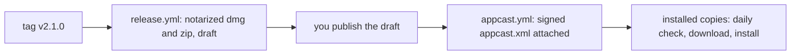

# Releasing Screencap

Releases are built by `scripts/release.sh VERSION`, on the maintainer's Mac or in GitHub Actions. The script builds from committed code and writes three files to `build/release/`:

- `Screencap-VERSION.dmg` is the download.
- `Screencap-VERSION.zip` is for updates.
- `Screencap-VERSION.sha256` holds their checksums.

Publishing the release adds a fourth file, `appcast.xml`, which is what installed copies read to find the update (see [Updates](#updates)).

The app and its OCR helper are signed with the Developer ID certificate (`Developer ID Application: Yahor Barkouski (ZY8VMC3J6G)`, valid until January 2031), with the hardened runtime and Apple's secure timestamp. The app is notarized and stapled first, so the copy inside the disk image opens offline; then the disk image is signed, notarized and stapled. A rejection prints Apple's log and stops the release. The build number (`CFBundleVersion`) is the commit count. `SCREENCAP_SKIP_NOTARIZE=1 scripts/release.sh 2.0.0-rc1` does everything except notarization.

The first full run, 2.0.0-rc1 on the maintainer's Mac on 2026-10-16, took about a minute and a half, and Apple accepted each of the two uploads in about 30 seconds. Gatekeeper (`spctl --assess`) accepted a quarantined copy of the disk image, the app inside it and the app in the zip, each as `source=Notarized Developer ID`. The disk image is 5.4 MB and the zip 5.0 MB.

## CI

- `.github/workflows/ci.yml` builds and runs the tests on every push to `main` and every pull request, on GitHub's `macos-26` runner, and assembles an ad hoc signed bundle.
- `.github/workflows/appcast.yml` runs when a release is published or its notes are edited. It downloads the release's zip, signs it with the `SPARKLE_ED_PRIVATE_KEY` secret, writes `appcast.xml` with the release notes, and attaches it to the release.
- `.github/workflows/release.yml` runs on a tag such as `v2.0.0`. It imports the certificate from the repository secrets into a throwaway keychain, runs `scripts/release.sh`, and opens a **draft** release with the three files. Nothing is public until you publish the draft. Run it by hand (Actions → Release → Run workflow, version `2.0.0-rc1`) to check signing and notarization: the files are kept as a workflow artifact for 7 days and no release is made.

## Once, by hand

Only you can do these.

1. **Apple agreements.** Done on 2026-10-16, when two were waiting. Apple adds new ones from time to time: accept every agreement shown at [developer.apple.com/account](https://developer.apple.com/account) and in [App Store Connect → Business](https://appstoreconnect.apple.com/business). Until all are accepted, notarytool refuses every request with `HTTP status code: 403. A required agreement is missing or has expired`, and an acceptance takes a few minutes to reach the notary service. The Developer Program membership must also be active.
2. **GitHub secrets.** None to add: `yahorbarkouski/screencap` already holds the five the Electron releases used (`APPLE_CERT_P12_BASE64`, `APPLE_CERT_P12_PASSWORD`, `APPLE_ID`, `APPLE_APP_SPECIFIC_PASSWORD`, `APPLE_TEAM_ID`, set in January 2026). The v2.0.0 run on 2026-10-16 signed and notarized with them. If a later run fails to sign in to the notary service, make a new app-specific password at [account.apple.com](https://account.apple.com) → Sign-In and Security → App-Specific Passwords and run `gh secret set APPLE_APP_SPECIFIC_PASSWORD -R yahorbarkouski/screencap`.
3. **Update signing key.** Installed copies accept an update only if it is signed with this Ed25519 key, and the public half is built into every copy, so the key is made once and kept for good. It was made on 2026-10-16 with `generate_keys --account screencap` (after `swift package --scratch-path .build/app resolve`, the tool is at `.build/app/artifacts/sparkle/Sparkle/bin/generate_keys`). The private key is in the maintainer's login Keychain, and the public key, `x5rTm9SbjOVsZ5fLTKAdYnCXTtVYshoxsqqPZCiCVc0=`, is `ED_PUBLIC_KEY` near the top of `scripts/build-app.sh`. To give CI the private key and delete the exported copy:

   ```sh
   .build/app/artifacts/sparkle/Sparkle/bin/generate_keys --account screencap -x sparkle-key.txt
   gh secret set SPARKLE_ED_PRIVATE_KEY -R yahorbarkouski/screencap < sparkle-key.txt
   rm sparkle-key.txt
   ```

   Also save the private key in your password manager. If it is lost, no installed copy will accept another update, and every user has to download a new version by hand once.
4. **Release approval** (optional). Settings → Environments → `release` → add yourself as a required reviewer, so every release run waits for your approval. The environment appears after the first run, or create it there first.
5. **Private vulnerability reporting.** Settings → Security → enable it, since the README asks people to report security issues there.
6. **Releases from your Mac** (optional; CI does it too). The script signs in to Apple's notary service from `SCREENCAP_NOTARY_APPLE_ID`, `SCREENCAP_NOTARY_PASSWORD` (the app-specific password) and `SCREENCAP_NOTARY_TEAM_ID`, which `release.yml` fills from the `APPLE_ID`, `APPLE_APP_SPECIFIC_PASSWORD` and `APPLE_TEAM_ID` secrets. When those are unset, it uses an App Store Connect API key if `SCREENCAP_NOTARY_KEY` is set (see the top of `scripts/release.sh`), and otherwise the keychain profile `screencap-notary`, made once:

   ```sh
   xcrun notarytool store-credentials screencap-notary --apple-id <your Apple ID> --team-id ZY8VMC3J6G
   ```

## Each release

1. Commit everything; the script refuses to build while `Sources`, `Resources`, `scripts` or the package files have uncommitted changes.
2. Tag and push: `git tag v2.1.0 && git push origin v2.1.0`. Approve the run, wait for the draft (each of the two notarizations took about 30 seconds in the first run, and Apple can take a few minutes), check the files, and publish it with release notes.
3. From your Mac instead: `scripts/release.sh 2.1.0`, then `gh release create v2.1.0 build/release/Screencap-2.1.0.{dmg,zip,sha256} --draft`, and publish it.
4. Publishing starts `appcast.yml`, which attaches `appcast.xml` within about two minutes. Installed copies find the update at their next daily check. To confirm, `curl -sL https://github.com/yahorbarkouski/screencap/releases/latest/download/appcast.xml` should show the new version. Editing the notes later rewrites the appcast.

## Decided for the first public release (2026-10-16)

Both were carried out on 2026-10-16: v1.36.0 shipped the notice, the Electron code is tagged `electron-final`, and v2.0.0 was built from the commit that replaced `main`.

- **Where the source lives.** `yahorbarkouski/screencap`. Its Electron history is tagged `electron-final`, then `main` is replaced in one commit on top of it, with no force-push. The public tree is cut from the private development repository, without its plans, experiments and progress log.
- **How users of the old app hear about it.** The old Electron app (`com.screencap.app`) updates itself from that repository's releases through `latest-mac.yml`. The last Electron release, 1.36, shows a notice that links to Screencap 2 once a 2.x release is the latest. Once v2.0.0 is the latest release without a `latest-mac.yml`, the old app stays on 1.36. The new app has its own identifier, `com.screencaping.app`, and no history moves over from the old one.
- **Which Macs it runs on.** macOS 26 on Apple Silicon. The old app also ran on Intel and older systems.

## Updates

Screencap updates itself with [Sparkle](https://sparkle-project.org) 2.10.0, a SwiftPM dependency embedded in `Contents/Frameworks` and signed by `scripts/build-app.sh`. The app reads `https://github.com/yahorbarkouski/screencap/releases/latest/download/appcast.xml`. GitHub serves that address from the latest published release, which excludes drafts and pre-releases, so an update reaches users only when you publish it.



- **Checks.** Once a day, on by default, without asking first. The request carries Sparkle's User-Agent (app and Sparkle versions) and nothing else.
- **Install.** By default the update downloads in the background and installs the next time the screen locks or the display sleeps, then the app reopens without showing a window. The panel's arrow button and Restart to Update in the right-click menu install it right away; quitting installs it too. With automatic installs off in Settings → Updates, the panel shows the update and Sparkle's window asks first.
- **Trust.** The app accepts the feed and the zip only with valid signatures from the update key (`SURequireSignedFeed` and `SUVerifyUpdateBeforeExtraction`). Sparkle then checks that the new app has the same Developer ID signature. macOS ties Screen Recording and Accessibility grants to that signature and the bundle identifier, so they should carry over to the updated app; the first local test ran without grants and did not check this. Screencap 2.0.0 has no updater; its users move to the first updating release by hand.

### Testing an update locally

`scripts/update-test.sh KEY_DIR [PORT]` builds two copies signed with your Developer ID under the identifier `com.screencaping.app.updatetest`, with their own store, settings and Keychain items, so the installed app is untouched. Build 1000 (0.0.1) updates to build 1001 (0.0.2) from a feed on `127.0.0.1` signed with a throwaway key: `KEY_DIR` holds `private.txt` and `public.txt`, made with the three `openssl` commands at the top of the script. The script only builds the two copies and writes the feed into `build/update-test`; it starts no server. Copy `build/update-test/old/Screencap.app` to a scratch folder, serve the feed with `python3 -m http.server 8471 --bind 127.0.0.1 --directory build/update-test` (8471 is the script's default port, its second argument), run `defaults write com.screencaping.app.updatetest SULastCheckTime -date "2020-01-01 00:00:00 +0000"` so the next launch checks at once, open the copy, and follow `log stream --level info --predicate 'subsystem == "com.screencaping.app" OR subsystem BEGINSWITH "org.sparkle-project"'`. The copy has no Screen Recording grant, so it opens onboarding each launch.

The first run, on 2026-10-16, checked: a background install on quit; Restart to Update, which relaunched build 1001 within a second with no main window; automatic installs off, where the panel showed the update and Sparkle's window installed it; a zip altered after signing, refused before unpacking; a feed signed with another key, refused before the download; and an update to a notarized 0.0.3 zip made by `scripts/release.sh`, which Apple accepted with Sparkle inside and Gatekeeper passed after the update.
