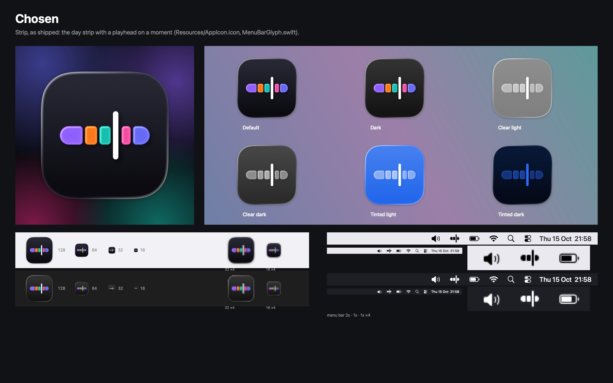

# Screencap's logo

Screencap's icon is the day strip, the strip of thread colours that the menu-bar popup shows, with a white playhead on a moment past the middle of the day. The menu bar glyph is the same picture in one colour: three pieces of strip and the playhead between the last two.



The icon is drawn from vector layers in Icon Composer's format (`Resources/AppIcon.icon`), so macOS 26 renders it in Liquid Glass: it adds the glass edges and shadows itself, and it derives the dark, clear and tinted appearances. The glyph is drawing code (`Sources/Screencap/UI/MenuBarGlyph.swift`).

## How it was chosen

Twelve directions were drawn and rendered the way macOS 26 draws them, into contact sheets: `overview.jpg` shows them all, and `<direction>.jpg` (for example `strip.jpg`) shows each in full. Two stood out:

- **Strip**, the day strip with a white playhead, reads at every size and is the app's own picture. It can also read as a media scrubber or an audio app.
- **Lens**, a frosted pane over the strip, uses Liquid Glass as the idea itself: the blur is the moment the screen held still. 22 variants refined it into Lens T, all on `lens/variants.jpg`: `lens-a` to `lens-t` (the letters skip m and n, and `lens-r1` to `lens-r3` differ from `lens-r` only in their glyph) and `lanes-m`.

Lens T shipped first, in commit 7c66ce2. After seeing these sheets, Yahor chose Strip on 2026-10-15, so Strip ships and Lens T is the runner-up. To ship Lens T instead, from the repository root:

```bash
python3 research/logo/directions.py Resources --ship lens-t   # rewrites Resources/AppIcon.icon
git checkout 7c66ce2 -- Sources/Screencap/UI/MenuBarGlyph.swift
```

then set the `statusItem` property in `Sources/Screencap/UI/Windows.swift` to `NSStatusItem.variableLength` (Lens T's glyph is 27 pt wide), run `scripts/make-icon.sh`, and rebuild the app with `scripts/build-app.sh`.

Two later rounds were drawn and set aside, and Strip stays: `round2/` tries familiar objects on gradient fields (finalists Keep, a window with a bookmark ribbon; Threads, three flowing ribbons; Window, the strip inside a white window), and `strips/` draws the strip ten more ways on the same ink background (Caret, Bar and Tall were the strongest). Each folder has an `overview.jpg`.

Seven of the Lens variants decided Lens T, each fixing what the one before got wrong; each has its sheet in `lens/` (for example `lens/lens-a.jpg`):

| Step | What changed | What it showed |
|---|---|---|
| `lens-a` | A portrait pane over a short strip | The motif filled too little of the square: in the Dock beside Apple's icons it looked small and grey (`dock.jpg`, whose rows are Strip, Lens T and Lens A) |
| `lens-i` | Bigger, the strip running off both edges, the strip flat so the pane is the only glass | Strong presence, and it read as a smartwatch on its strap, a risk under [Apple's app icon guidelines](https://developer.apple.com/design/human-interface-guidelines/app-icons), which forbid replicas of Apple hardware |
| `lens-l` | A landscape pane that dominates the square | It still read as a strap, through a buckle |
| `lanes-m` | Three thread lanes behind the pane | Too busy at Dock size |
| `lens-p` | The strip enters from the left and ends under the pane, which stands for the present moment | Too little colour at Dock size |
| `lens-r` | Two thread pieces show on each side of the pane | The strip reads as segmented time, and the strap is gone |
| `lens-t` | A wider, lower pane with a screen's proportions | More colour inside the pane, less grey; the runner-up |

`glyphs.jpg` shows the shipped Strip glyph and the five drawings weighed for Lens T's, each in a light and a dark menu bar, at 2x on the left and at 1x magnified twice on the right. For Lens T, two pieces of strip a side looked like an ellipsis at real size, and a solid pane looked like a pill; one piece a side and a 1.5 pt pane outline stayed distinct beside the battery and Wi-Fi icons.

## The twelve directions

| Direction | Idea | Verdict |
|---|---|---|
| Strip | The day strip with a playhead on a moment | Shipped: clear at every size, though it can read as a media scrubber |
| Moment | The popup in one picture: the strip above, the screenshot card it shows for a moment below | Reads as a browser window or a calendar |
| Lens | A frosted pane over the strip | Runner-up, as Lens T after the variants above |
| Lift | One piece of the strip lifted out of it | Reads as a Tetris piece |
| Week | A week of strips stacked a day per row | Reads as a keyboard |
| Columns | The timeline's columns, one per thread | Reads as a chart |
| Ring | A 24-hour dial of thread arcs with a bead at now | Reads as a power or refresh symbol |
| Coil | The strip wound into a rounded square spiral | Its glyph reads as a letter G |
| Braid | Three threads plaited | Reads as waves; noise at 16 px |
| Tiles | The day as a mosaic of thread-coloured tiles | Generic: a calendar or launcher grid |
| Knot | A thread with one loop, the string tied round a finger | Reads as a stick figure |
| Aurora | The aurora behind the screenshots in the repository's `README.md`, under a frosted pane | Generic: a display on a gradient |

A first round also drew a thirteenth, **Nest**, nested screen frames settling inward; it read as a button and was dropped without a sheet.

Every sheet shows the icon at 1024 px on the dark aurora backdrop of the screenshots in `README.md`, the six macOS 26 appearances (default, dark, clear light, clear dark, tinted light, tinted dark), 128 to 16 px at real size on light and dark backgrounds with 32 and 16 magnified four times, and the glyph in light and dark menu bars at 2x and 1x beside the system's own menu bar icons.

## How the icon ships

- `scripts/build-app.sh` compiles `Resources/AppIcon.icon` with `actool` on every build into the bundle's `Assets.car` (the layered icon macOS 26 draws) and `AppIcon.icns` (a flat fallback, 16 to 256 px). `Info.plist` names both: `CFBundleIconName` and `CFBundleIconFile`, each `AppIcon`. `actool` exits 0 even when it compiled nothing, so the script checks that `Assets.car` exists, and it passes `actool` absolute paths (see the facts below).
- The onboarding window's first step shows `NSApp.applicationIconImage`, which resolves to the bundle's icon. Its last step, "Screencap is in your menu bar", shows the glyph.
- `scripts/release.sh` puts the flat `AppIcon.icns` on the disk image as its volume icon.
- `docs/readme/logo.png` is the icon as macOS 26 draws it, 512 px with clear margins, for the README or anywhere else the icon is shown as a picture. `README.md` doesn't show it at the moment. `scripts/make-icon.sh` regenerates it.

`Resources/AppIcon.icon` is the icon's source. To change it, open it in Icon Composer (Xcode > Open Developer Tool), or edit its SVG layers and `icon.json`, then run `scripts/make-icon.sh` to refresh `docs/readme/logo.png`, and rebuild the app, which compiles the icon. It was written by `python3 research/logo/directions.py Resources --ship`, which draws Strip from its numbers in `directions.py` into `Resources/AppIcon.icon`; running that again overwrites any edits made since.

## Rendering the sheets

From the repository root, in this order:

```bash
research/logo/render.sh "$TMPDIR/logo"
research/logo/render.sh "$TMPDIR/logo" --lens
research/logo/render.sh "$TMPDIR/logo" --chosen
```

The directory argument holds the intermediate renders; the sheets are written straight into `research/logo/`. The first command writes the twelve directions, the second the Lens variants into `lens/`, and the third the shipped icon and glyph (`chosen.jpg`) with `dock.jpg` and `glyphs.jpg`, which reuse renders from the first two.

`directions.py` draws every direction as SVG layers and an `icon.json`. `render.sh` compiles each with `actool`, wraps it in a throwaway bundle, and renders it with `scripts/icon-render.m`, which asks IconServices for a given appearance through a private image descriptor (a development tool; the app never uses it). The Swift files in `research/logo/tools/` lay out the pictures: `contact.swift` the sheets, `context.swift` the Dock rows, `glyph.swift` the shipped glyph's 1x and 2x renders, and `glyphs.swift` the glyph comparison.

Facts that came out of building this, measured on macOS 26.5 with Xcode 26.4:

- `actool` hands its work to a long-lived helper that resolves relative paths against the helper's own working directory, which can be another checkout. With relative paths, a build in one worktree wrote its icon into another checkout's `build/Screencap.app` and broke that bundle's signature, so every script here gives `actool` absolute paths.

- `NSWorkspace.icon(forFile:)` drew the same image under the light and the dark `NSAppearance`, so it can't render a chosen appearance. IconServices' `ISImageDescriptor` takes an explicit `appearance` (0 light, 1 dark) and `appearanceVariant`: 0 for the default and dark looks, 2 for clear, and 2 with a `tintColor` for tinted.
- IconServices may hand back a cached icon for a bundle path it has seen, so each render uses a fresh bundle path and identifier.
- The menu bar is 24 pt tall, and Apple's guidelines describe menu bar extras as black-and-clear images that the system tints for light, dark and selected bars. The Strip glyph is 22 × 22 pt and fits a square status item (`NSStatusItem.squareLength`); Lens T's was 27 pt wide and needed `NSStatusItem.variableLength`.
