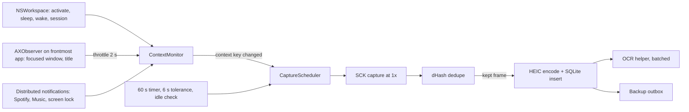

# Screencap platform research: capture, storage, OCR, context, store, shell, backup

Date: 2026-10-14. Reader: Yahor, and whoever plans the Swift rebuild. Each section ends with a recommendation; section 8 turns them into a performance budget.

## Recommendations at a glance

| Area | Recommendation | Key number |
|---|---|---|
| Capture | `SCScreenshotManager.captureImage` at 1x (point) resolution, cached `SCShareableContent`, one filter per display that excludes Screencap and password managers; skip when secure input is on | ~40 ms wall, ~0.6 ms app CPU, ~7 ms `replayd` CPU per capture, at any output size |
| Dedupe | 64-bit dHash (difference hash) of the captured frame with the menu-bar strip masked; drop exact or near matches before encode, OCR, storage and upload | hash < 0.1 ms; old app data shows 16–37% of frames are duplicates |
| On-disk format | HEIC q0.6 at 1x via ImageIO (hardware encoder) | 135 KB/frame, 9 ms CPU, OCR keeps 94.5% of words |
| Retention | 1x HEIC for 90 days locally; 480 px thumbnail, OCR text and context forever; full frames forever in cloud backup | ~61 MB/day local at 1-min cadence |
| OCR | `RecognizeTextRequest` accurate, language correction off, at 1x, in a separate helper process at utility QoS; skip duplicates | 261 ms wall, 457 ms CPU, ~1.5 J, +236 MB while running |
| Context | Event-driven: NSWorkspace notifications, `AXObserver` (throttled), AX `AXURL` for browsers, distributed notifications for media; no polling, no `osascript` | idle shell 0.09% of one core, 12 MB |
| Store | GRDB `DatabasePool` (WAL) + FTS5 external-content index; in-memory brute-force vectors | 23 µs per capture commit; 100k × 512 vector search in 1.1 ms |
| On-device LLM | Foundation Models is optional (Apple Intelligence is off on this Mac); use it only as an offline fallback for naming threads | 4,096-token context; not measurable here |
| Shell | `NSStatusItem` + preloaded non-activating `NSPanel`; AppKit `NSTableView` timeline; `SMAppService`; Sparkle ≥ 2.9.2; Developer ID, notarized, not sandboxed | |
| Backup | Cloudflare R2 Standard, one AES-GCM-sealed object per kept frame, SigV4-signed PUTs from a SQLite outbox | ~1.6 GB/month; $0.13/month after a year |

## 0. Method and test machine

- MacBook Pro, Apple M4 Max (12 performance + 4 efficiency cores), 64 GB, macOS 26.5 (25F71), Xcode 26.4, Swift 6.3. One built-in display: 3456 × 2234 pixels, 1728 × 1117 points (scale 2).
- Screen Recording and Accessibility were already granted to the process that ran the benchmarks, so capture and AX were measured for real. Apple Events to browsers were not granted, and the benchmarks never triggered a permission prompt.
- Benchmarks are Swift programs in `research/platform-bench/scripts/`; raw outputs are in `research/platform-bench/out/*.txt`. Build any of them with `DEVELOPER_DIR=/Applications/Xcode.app/Contents/Developer swiftc -O -parse-as-library Measure.swift <name>.swift -o <name>` (`encode.swift` also needs `-import-objc-header webp_bridge.h -I/opt/homebrew/include -L/opt/homebrew/lib -lwebp`; `fm.swift` needs `-target arm64-apple-macosx26.4`).
- Inputs: 30 randomly sampled WebP originals from the old Electron app (seed 42, list in `out/sample_list.txt`), 2 of its PNG originals, and 6 fresh lossless full-resolution captures of the screen. All copies and captures were deleted after the runs; no image left the machine.
- "Energy" is the kernel's per-process estimate (`proc_pid_rusage`, `ri_energy_nj`). It covers the measured process only. WindowServer cost could not be isolated: it used 6–12 s of CPU per 32 s window from normal desktop use, which swamps the capture signal.
- Noise: the desktop was in use, and another agent's OCR process was running at ~160% CPU around the first capture run. Medians are reported; treat differences under ~10% as noise.

### What the old app's data says

The Electron app (v1, setting `captureInterval: 2` minutes, `retentionDays: 30`) recorded, on the 13 full days of the last 35:

| Fact | Value |
|---|---|
| Captures per full day at 2-min cadence | mean 253 (range 182–315), so ~8.4 tracked hours |
| App switches per day seen at 2-min sampling | 65 (a lower bound) |
| Captures merged as "similar" by its fingerprint rule | 16% |
| Stored frames whose 8 × 8 dHash equals the previous frame on the same display | 25% of the rest; ~37% combined |
| WebP originals | 4,291 files at 1280 px wide, mean 68 KB, median 62 KB, ~285 MB |
| PNG originals | 191 files, all written 2026-10-14, 2560 × 1655, 12.7 MB each (stored without compression), 2.36 GB |

The 191 PNGs are 94% of the 2.5 GB folder. Something wrote uncompressed full-size PNGs today; it is worth finding before it fills the disk.

The old fingerprint rule (`electron/main/features/capture/FingerprintService.ts`) is two dHashes, 8 × 8 with blur 1.2 and 16 × 16 with blur 0.3, with the top-right corner (top 20% of rows, right 25% of columns) masked so the menu-bar clock does not count. Frames are similar when the distances are ≤ 4 and ≤ 24 bits.

## 1. Capture

### APIs on macOS 26

| API | Since | What it does |
|---|---|---|
| `SCScreenshotManager.captureImage(contentFilter:configuration:)` | 14.0 | One `CGImage` (8-bit BGRA by default) from a filter; output size set in `SCStreamConfiguration.width/height` |
| `SCScreenshotManager.captureSampleBuffer(...)` | 14.0 | Same, as a `CMSampleBuffer` |
| `SCScreenshotManager.captureImage(in: CGRect)` | 15.2 | A rect in global screen points, across displays, with no filter (so no exclusions) |
| `SCScreenshotManager.captureScreenshot(contentFilter:configuration:)` with `SCScreenshotConfiguration` | 26.0 | Returns `SCScreenshotOutput` with `sdrImage` and/or `hdrImage`; can write HEIC, PNG or JPEG to `fileURL`; has `sourceRect`, `ignoreShadows`, `includeChildWindows`, `displayIntent` |
| `SCStream` | 12.3 | Continuous frames, with per-frame `status` (`.idle` when nothing changed) and dirty rects |
| `CGWindowListCreateImage` | obsoleted in 15.0 | Unavailable in the macOS 26 SDK (`CGWindow.h`: `SCREEN_CAPTURE_OBSOLETE(10.5,14.0,15.0)`) |

Two observations from the macOS 26 API on 26.5:

- With `fileURL` and `contentType = .heic` set, the call succeeded but wrote no file and returned `fileURL == nil`. Encode with ImageIO yourself.
- `dynamicRange = .bothSDRAndHDR` returned a 16-bit-per-channel SDR image and no HDR image, because nothing on screen was HDR. HDR frames double memory and add nothing for OCR or the decider; request `.sdr`.

### Measured cost per capture

10 captures per row, 150 ms apart; "replayd" is the ScreenCaptureKit daemon (`/usr/libexec/replayd`).

| Call | Output | Wall median | Wall p90 | App CPU | replayd CPU | replayd energy |
|---|---|---|---|---|---|---|
| `SCShareableContent` (on-screen windows) | 1 display, 9 windows | 18.0 ms | 20.5 ms | 0.8 ms | 0.6 ms | 1.3 mJ |
| `captureImage` | 3456 × 2234 (native) | 42.1 ms | 49.6 ms | 0.8 ms | 4.6 ms | 11.9 mJ |
| `captureImage` | 1728 × 1117 (1x) | 40.8 ms | 45.1 ms | 0.5 ms | 4.5 ms | 12.2 mJ |
| `captureImage` | 1280 × 827 | 37.6 ms | 42.9 ms | 0.6 ms | 4.8 ms | 12.8 mJ |
| `captureImage` | 64 × 41 (probe) | 38.0 ms | 46.0 ms | 0.6 ms | 4.5 ms | 12.3 mJ |
| `captureImage`, 5 apps excluded | 1x | 36.8 ms | 39.3 ms | 0.8 ms | 6.3 ms | 12.6 mJ |
| `captureScreenshot` (26), SDR | 1x | 37.6 ms | 40.1 ms | 0.4 ms | 4.7 ms | 12.4 mJ |
| `captureImage(in:)` (15.2) | full display | 18.6 ms | 20.2 ms | 0.4 ms | 3.2 ms | 10.8 mJ |
| `SCStream` start → first frame → stop | 1x | 48.0 ms | 61.1 ms | 1.2 ms | 10.6 ms | 30.1 mJ |
| `screencapture -x` (CLI, includes PNG encode) | native | 210 ms | | 110 ms | | |

An A/B run (30 s with one 1x capture per second against 30 s idle, twice) put replayd at 225–244 ms against 20–22 ms idle, so **~7 ms of replayd CPU per capture** including teardown. In-app cost stays under 1 ms.

What this means:

- Capture cost is fixed at ~40 ms wall and ~5–7 ms of daemon CPU regardless of output size; most of the wall time is likely spent waiting for the next composited frame. A tiny "has anything changed?" probe costs as much as a real capture, so dedupe after capturing and use it to skip the expensive steps (encode, OCR, storage, upload).
- Ask SCK for 1x directly (`width/height` in points). The GPU scales for free, and a 1x BGRA frame is 7.7 MB in memory against 30.9 MB at native.
- Fetching `SCShareableContent` costs 18 ms. Cache it and refresh on app launch/terminate notifications, on display reconfiguration (`CGDisplayRegisterReconfigurationCallback`) and when the exclusion list changes. The prior Swift attempt fetched it before every capture (`ScreencapCore/Evidence/NativeCaptureAdapters.swift`).
- `captureImage(in:)` is twice as fast but cannot exclude apps; use it only when no exclusions apply.
- A long-running `SCStream` gives change detection for free (idle frames, dirty rects), but it costs more per frame and keeps the screen-recording indicator on. Screenshots fit a 1–2 minute cadence better.

### Change detection

| Method | Cost | Notes |
|---|---|---|
| dHash + 64 × 40 grayscale thumbnail of the captured frame | 9–90 µs | Consecutive probes of an unchanged screen gave Hamming distance 0 and mean absolute difference 0.00, so exact-match dedupe is safe on static screens |
| SCK probe capture at 64 px | ~38 ms wall + ~5 ms replayd | Same as a full capture; no saving |
| `SCStream` idle frames / dirty rects | continuous stream | Indicator stays on |

Use the old app's rule as the starting point: mask the menu-bar strip, compare an 8 × 8 and a 16 × 16 dHash against the last kept frame on the same display, and treat the frame as a duplicate when the context key (section 4) is also unchanged. One caveat from a first attempt: a 9 × 8 downscale drawn straight from a 3456-px image with `CGContext` at `.medium` interpolation aliased badly (its hash differed from the hash of an SCK-scaled 64-px probe of the same screen). Hash an area-averaged downscale, such as `vImageScale` or a 64-px intermediate.

### Privacy and secure input

- **Exclusions**: `SCContentFilter(display:excludingApplications:exceptingWindows:)` with Screencap itself, password managers (the prior attempt's list: 1Password, Bitwarden, Keychain Access) and the user's list. Excluding five apps added no measurable cost.
- **Secure input**: `IsSecureEventInputEnabled()` (Carbon) costs under 1 µs and is true while any password field or Terminal's Secure Keyboard Entry has focus. Skip the capture when it is true.
- **Private browsing**: SCK has no flag for private windows. Chrome-family browsers expose `mode of window` (`"normal"` or `"incognito"`) over Apple Events; otherwise exclude specific `SCWindow`s by ID once identified. Safari, Arc and Dia private windows need a per-browser test.
- **Permission prompts**: since macOS 15, apps that capture without the system picker get a monthly "bypass the private window picker" prompt ([9to5Mac](https://9to5mac.com/2024/08/14/macos-sequoia-screen-recording-prompt-monthly/)). Whether macOS 26 still shows it was not verifiable here; the old app's behavior on 26.5 answers it. On 26.1+, bare executables that capture never appear in the Screen Recording list ([Apple forums](https://developer.apple.com/forums/thread/807898)), so capture must run inside the app bundle.

### Multi-display

Only one display was connected, so multi-display was not benchmarked. Each display needs its own filter and capture (~40 ms each; they can run concurrently). Capture the display that holds the focused window on every tick and on every context switch; capture other displays on the timer only, and drop them as duplicates when their hash has not changed. The old app saw 5 display IDs, with 72% of frames on the built-in display.

**Recommendation.** 1x SDR `captureImage` per display with a cached filter, triggered by the 60 s timer and by context switches (section 4), skipped under secure input or when idle, and deduplicated by dHash after capture.

## 2. Encoding and storage

ImageIO on macOS 26 encodes JPEG, PNG, HEIC, AVIF (`public.avif`) and others, but not WebP; WebP was measured through libwebp (`WebPEncodeBGRA`, method 4) linked in-process. "OCR recall" is the share of words (≥ 3 characters) that accurate OCR reads from the lossless frame and still reads from the encoded one, pooled over all frames.

### Lossless captures at 1x (6 frames, 1728 × 1117)

| Format | Median size | Encode wall | Encode CPU | Decode | OCR recall |
|---|---|---|---|---|---|
| PNG | 1,093 KB | 50.2 ms | 50.1 ms | 14.1 ms | reference |
| JPEG q0.6 | 235 KB | 4.2 ms | 4.2 ms | 4.8 ms | 94.7% |
| JPEG q0.8 | 332 KB | 4.9 ms | 4.9 ms | 3.9 ms | 95.9% |
| HEIC q0.4 | 86 KB | 30.9 ms | 9.0 ms | 12.0 ms | 93.7% |
| **HEIC q0.6** | **135 KB** | **30.5 ms** | **8.8 ms** | **13.3 ms** | **94.5%** |
| HEIC q0.8 | 177 KB | 30.5 ms | 8.9 ms | 13.6 ms | 95.8% |
| AVIF q0.4 | 62 KB | 82.2 ms | 253.7 ms | 16.1 ms | 92.9% |
| AVIF q0.6 | 105 KB | 85.4 ms | 265.4 ms | 15.6 ms | 95.1% |
| WebP q60 | 87 KB | 69.4 ms | 69.4 ms | 7.0 ms | 93.6% |
| WebP q80 | 119 KB | 73.0 ms | 73.0 ms | 8.1 ms | 95.2% |

At native resolution (3456 × 2234) the same frames cost: PNG 3,759 KB; JPEG q0.8 972 KB (18 ms); HEIC q0.6 363 KB (49 ms wall, 15 ms CPU); AVIF q0.6 278 KB (1.4 s CPU); WebP q80 329 KB (258 ms). At 1280 px: HEIC q0.6 85 KB, WebP q80 74 KB, JPEG q0.8 211 KB, AVIF q0.6 67 KB.

### Real originals (30 old WebP files, 1280 px, mean 70.5 KB)

WebP decode takes 4.6 ms. Re-encoded, they average HEIC q0.6 81 KB, WebP q80 68 KB, JPEG q0.8 183 KB, AVIF q0.6 61 KB. The 6 fresh frames at 1280 px average 84 KB as HEIC q0.6, close to the 81 KB of the real sample, so the fresh frames are representative for size.

### How much resolution OCR needs

Accurate OCR on the 6 lossless frames read 1,100 words at native resolution. Downscaled versions recovered:

| Width | Share of native words read | Accurate OCR latency |
|---|---|---|
| 3456 (native) | 100% | 295 ms |
| 1728 (1x) | 94.5% | 264 ms |
| 1280 (old app) | 90.1% | 256 ms |
| 1024 | 70.8% | 257 ms |

Legibility falls off below 1280 px, and OCR latency barely changes with resolution. Re-encoding a frame at JPEG q0.8 still changes ~4% of OCR words, so recall differences under 2 points between formats are noise.

### Recommendation

- **Store HEIC q0.6 at 1x.** It uses the hardware encoder (9 ms CPU against 73 ms for WebP and 254 ms for AVIF), decodes in hardware in the timeline, and costs 135 KB. WebP q80 is 12% smaller at 8× the CPU and needs a libwebp dependency; AVIF is 22% smaller at 30× the CPU.
- **OCR the in-memory frame before encoding**, so the storage quality only affects what the user and the decider see.
- **Send the decider JPEG.** Perplexity accepts PNG, JPEG, WebP and GIF only, and bills an image at (width × height) / 750 tokens ([docs](https://docs.perplexity.ai/guides/image-attachments)): 2,574 tokens at 1728 × 1117 and 1,413 at 1280 × 828. Transcode the kept frame to JPEG q0.8 at 1280 px (3 ms, ~200 KB) when an image is sent.
- **Retention**: full 1x HEIC for 90 days locally (~1.6 GB per month at 1-min cadence after dedupe); a 480 px HEIC q0.5 thumbnail (13 KB; 640 px is 21.5 KB) of every kept frame, the OCR text and the context forever (~2.4 GB per year: 1.9 GB of thumbnails, ~0.5 GB of database); every kept 1x frame forever in the cloud backup (section 7). Native resolution is 2.7× the bytes for ~6% more OCR words; if those words matter, OCR the native frame in memory and still store 1x.

## 3. OCR

The Swift Vision API is `RecognizeTextRequest` (macOS 15+), called as `try await request.perform(on: cgImage)`. "LC" is language correction (`usesLanguageCorrection`), a language-model pass that rewrites recognized words.

### Measured latency (median per frame)

| Input | Config | Wall | Wall p90 | CPU | Energy | Characters |
|---|---|---|---|---|---|---|
| 1x, 6 frames | fast, no LC | 36.8 ms | 41.6 ms | 36.2 ms | 0.17 J | 1,487 (29% of accurate's words) |
| 1x | accurate, no LC | **261 ms** | 307 ms | **457 ms** | **1.47 J** | 1,816 |
| 1x | accurate, LC | 451 ms | 573 ms | 1,711 ms | 4.81 J | 1,809 |
| native, 6 frames | fast, no LC | 56.6 ms | 100.8 ms | 55.5 ms | 0.24 J | 1,754 (83% of accurate's words) |
| native | accurate, no LC | 257 ms | 303 ms | 447 ms | 1.46 J | 1,813 |
| native | accurate, LC | 457 ms | 560 ms | 1,478 ms | 4.64 J | 1,815 |
| 1280 px old WebP, 30 frames | accurate, no LC | 214 ms | 313 ms | 320 ms | 1.06 J | 1,224 |
| 1280 px old WebP | fast | | | | | nothing, at any setting |

- First request in a process: accurate 510–714 ms, fast 35–60 ms.
- Memory: one accurate pass raised the process footprint from 11 MB to 247 MB; 175 MB was still resident 5 s later.
- Text per frame: median 1.35–1.84 KB (about 350–460 tokens).
- Language correction triples CPU and changed 5–12% of words; screen text is full of identifiers and URLs, so leave it off.
- **Pitfall**: `RecognizeTextRequest.minimumTextHeightFraction` defaults to 1/32 (text shorter than 3% of image height is ignored). The fast path honors it and returned **zero observations** on every screenshot; accurate returned text anyway. Set it to 0 for fast. Fast still reads nothing at 1280 px and only 29% of words at 1x, so it is only usable on native frames.
- Languages: accurate supports 30 locales (including English, Russian, Ukrainian, Polish, German, Chinese, Japanese, Korean, Arabic); fast supports 6 Latin-script languages. `automaticallyDetectsLanguage` defaults to off with `en-US`; set `recognitionLanguages` explicitly (for example `["en-US", "ru-RU"]`) if Cyrillic text matters.

### Is OCR needed if the decider reads the image?

Yes, for four reasons:

1. **Local search.** FTS5 over OCR text is the only offline way to find "the screen where I saw X".
2. **Cheaper decider input.** 350–460 tokens of OCR text against 1,413–2,574 image tokens per frame. The decider can get text for every frame and images only at segment boundaries or when it is unsure.
3. **Privacy screening before upload.** Secrets and personal data can be detected in text before an image leaves the machine.
4. **Text-only judgments.** Decisions that run on text, such as Jev calls and dedupe rules, can use it without images.

**Recommendation.** Accurate, no LC, on the 1x frame, for kept (non-duplicate) frames only, in a separate helper process (an XPC service) that processes a batch and exits, scheduled with `NSBackgroundActivityScheduler` at utility QoS and deferred in Low Power Mode or under thermal pressure. That keeps the 236 MB model footprint out of the menu-bar process. Cost: ~0.46 s of CPU and ~1.5 J per kept frame.

## 4. Foreground context without polling storms

### What went wrong before

The Electron app read the foreground app and window with AppleScript/JXA through `osascript` on a polling loop, with 800 ms timeouts per call (`electron/main/features/context/applescript.ts`), plus per-browser AppleScript for URLs (`providers/ChromiumProvider.ts`). Commit `d78edaf` (2026-04-04) "stop foreground osascript storms" and `160d4b4` (2026-05-23) "replace persistent JXA foreground polling" moved the app/window read to a Swift helper using `NSWorkspace` + `CGWindowListCopyWindowInfo`, still polled. The prior Swift attempt (`Screencap/Platform/AppleScriptBrowserURLProvider.swift`) runs `NSAppleScript` on the main actor for every capture, which blocks the main thread on an IPC round trip to the browser.

### Measured costs

| Read | Median | CPU per call | Permission |
|---|---|---|---|
| `NSWorkspace.shared.frontmostApplication` | 0.1 µs | 0.3 µs | none |
| `CGWindowListCopyWindowInfo(.optionOnScreenOnly)` | 186 µs | 40 µs | Screen Recording (for titles) |
| AX focused window → `kAXTitleAttribute` | 34 µs | 13 µs | Accessibility |
| AX `AXURL` on the browser's cached `AXWebArea` (Dia) | 15 µs | 6.6 µs | Accessibility |
| First `AXWebArea` lookup in the focused window (Dia) | 0.4 ms | | Accessibility |
| `CGEventSource.secondsSinceLastEventType` | < 0.1 µs | 0.1 µs | none |
| `IsSecureEventInputEnabled()` | < 1 µs | | none |
| Apple Events to Dia | not measured | | Automation: would have prompted |
| `MRMediaRemoteGetNowPlayingInfo` (private) | returned nothing | | entitlement-gated for third-party apps since 15.4 (or nothing was playing) |

An `AXObserver` on Dia delivered 54 `AXTitleChanged` events in 20 s and 120 in 90 s while the user worked, because pages update their titles constantly. A 1.5 s trailing debounce never fired in 90 s. **Throttle** (handle the first event, then at most one more per 2 s window); do not debounce.

A minimal event-driven shell (status item, NSWorkspace observers, an `AXObserver` re-attached on each app activation, a 60 s timer with 6 s tolerance) used **81.7 ms of CPU in 90 s (0.09% of one core)**, 1.4 interrupt wakeups per second, and a 12 MB footprint (`scripts/idleshell.swift`).

### Design

`ContextMonitor` owns the current **context key**: bundle ID, normalized window title, and browser URL host + path. Each source pushes events; nothing polls. When the key changes, `CaptureScheduler` takes a capture (at most one per 10 s), and the 60 s timer covers long stretches in one window.

| Signal | Source | Cost |
|---|---|---|
| App switch | `NSWorkspace.didActivateApplicationNotification`; re-attach the `AXObserver` to the new app | one callback per switch |
| Window and title | `AXObserver`: `kAXFocusedWindowChangedNotification`, `kAXTitleChangedNotification`, throttled; read the title (34 µs) | ~3 events/s in a busy browser, 0.04% CPU |
| Browser URL | AX first: `AXURL` on the `AXWebArea` in the focused window (15 µs once cached). Chromium builds its web accessibility tree only after an assistive client asks (set `AXManualAccessibility` on the app element), which costs the browser memory and CPU; Dia already exposed it here, possibly because another assistive client had enabled it. Apple Events fallback per browser (`URL of active tab of front window`), one call per throttled context change, sent as a raw Apple Event (`NSAppleEventDescriptor.sendEvent(options:timeout:)`, macOS 12+) with a ~250 ms timeout off the main thread. `NSAppleScript` belongs on the main thread, where each browser round trip would stall the UI | microseconds (AX); an IPC round trip to the browser (Apple Events) |
| IDE workspace | Window title: Xcode, VS Code and Cursor put the workspace and file in it; document-based apps also expose `kAXDocumentAttribute` | free with the title |
| Media | Spotify posts `com.spotify.client.PlaybackStateChanged` and Music posts `com.apple.Music.playerInfo` distributed notifications with track info, no permission needed (not tested in this run). Browser media is covered by title and URL. Skip MediaRemote and the `mediaremote-adapter` workaround ([repo](https://github.com/ungive/mediaremote-adapter)), which runs through `/usr/bin/perl` | push |
| Idle | `CGEventSource.secondsSinceLastEventType(.combinedSessionState, eventType: kCGAnyInputEventType)` (raw value `~0`), checked on the timer tick; enter idle after 5 min. The prior attempt passes `.null` and polls every 15 s; verify `.null` reports input events | < 0.1 µs |
| Sleep, lock, user switch | `NSWorkspace.willSleep/didWake/screensDidSleep/screensDidWake/sessionDidResignActive/sessionDidBecomeActive`; distributed `com.apple.screenIsLocked` / `com.apple.screenIsUnlocked` | push |

Permissions: Accessibility (title, URL), Screen Recording (capture), and Automation per browser only if the Apple Events fallback is enabled.

## 5. Local store, search, embeddings and on-device models

### SQLite access layer

| Option | Fit |
|---|---|
| **GRDB 7** | `DatabasePool` runs WAL (write-ahead log: readers never block the writer) with concurrent reads, `ValueObservation` drives the UI, first-class FTS5 and migrations, Swift 6 concurrency. The prior attempt already pins 7.10.0 |
| SQLite.swift | Typed query builder; no pool or change observation; slower maintenance |
| SwiftData | No FTS5, little control over SQL, indexes or batching; poor fit for 100k+ rows written from background actors |
| raw `sqlite3` | Same engine as GRDB with more boilerplate |

The system SQLite is 3.45.3 with FTS5, JSON, R-tree and math functions. The macOS SDK's `sqlite3.h` does not declare `sqlite3_load_extension`, so loadable extensions such as sqlite-vec need a custom SQLite build (GRDB supports custom builds).

Synthetic benchmark (`scripts/store.swift`): 100,000 captures, about 8 months of kept frames at 1-min cadence (458 a day, 26 days a month), each with ~1.5 KB of OCR text, indexed by an FTS5 external-content table (`tokenize='unicode61 remove_diacritics 2'`).

| Measure | Result |
|---|---|
| Bulk insert including FTS | 9.0 s (90 µs per capture, including generating the text) |
| Database size | 323 MB |
| One capture row committed alone (WAL, `synchronous=NORMAL`) | 23 µs |
| FTS5 `MATCH`, top 20 by bm25 | 0.3–8 ms |

### Vector search

Brute-force cosine top-10 in memory with Accelerate (`cblas_sgemv`): 10,000 × 512 floats in 0.13 ms; 100,000 × 512 (195 MB) in 1.1 ms; 100,000 × 768 in 1.45 ms. At personal scale, keep vectors in a BLOB column and scan them in memory; sqlite-vec and approximate indexes add a custom SQLite build for no speed gain. Embed activities and segments (tens per day) and skip individual frames; at 30 per day the matrix grows ~22 MB per year.

### On-device embeddings

| Model | Dimensions | Latency per sentence | Notes |
|---|---|---|---|
| `NLEmbedding.sentenceEmbedding(for: .english)` | 512 | 6.3 ms | Static model, English |
| `NLContextualEmbedding(language: .english)` | 512 | 9.4 ms (mean-pooled) | Max 256 tokens; assets were already on disk; a token-level BERT-style model that was not trained for sentence similarity |
| Foundation Models | none | | The framework has no embeddings API in the macOS 26 SDK |
| Small Core ML sentence model (for example a MiniLM or E5 conversion) | 384–768 | not measured | Better retrieval quality; adds a ~30–130 MB model file |

Start with `NLContextualEmbedding` mean-pooled for local "related activity" lookups. If retrieval quality matters, use the embedding endpoint of the cloud provider the decider already calls, since the evidence is sent there anyway.

### Apple Foundation Models

`SystemLanguageModel.default.availability` on this Mac returned `.unavailable(.appleIntelligenceNotEnabled)`, so nothing could be measured. To measure: turn on Apple Intelligence in System Settings, then build and run `scripts/fm.swift`; it uses synthetic evidence only and times a one-line caption, a guided `@Generable` thread label, and prompts of increasing size.

What the SDK and Apple say:

- Text in, text out. No image input and no embeddings in the macOS 26 SDK.
- Context: 4,096 tokens per session, shared by instructions, prompt, schema and output ([Apple forums](https://developer.apple.com/forums/thread/791026)). Read `SystemLanguageModel.contextSize`, and on 26.4+ measure inputs with `tokenCount(for:)`.
- Availability can be `deviceNotEligible`, `appleIntelligenceNotEnabled` or `modelNotReady` (still downloading), and the user's language must be supported. The app needs a cloud path regardless.
- Options that fit this use: guided generation with `@Generable`, `UseCase.contentTagging`, `prewarm()`.
- Speed: Apple published 0.6 ms per prompt token to first token and 30 tokens/s on an iPhone 15 Pro ([Apple ML](https://machinelearning.apple.com/research/introducing-apple-foundation-models)). For a ~550-token evidence prompt and a ~40-token label that is ~0.3 s + ~1.3 s ≈ 1.6 s on a phone; Apple publishes no Mac numbers.

It can plausibly name a thread or write a one-line caption from a short text summary (app, titles, URLs, a few OCR lines), which fits in 4,096 tokens. It cannot see the image and cannot hold an hour of OCR text. Use it as an offline fallback for labels, never as the segmenter.

## 6. App shell

| Concern | Recommendation | Why |
|---|---|---|
| Menu bar entry | `NSStatusItem` + a non-activating `NSPanel` built at launch and kept hidden | Opens in one frame, can be shown, hidden and positioned from code, takes keyboard focus on demand. `MenuBarExtra` ([docs](https://developer.apple.com/documentation/swiftui/menubarextra)) has no API to open or close its window programmatically. The prior attempt already has an AppKit status panel (420 × 330) |
| Timeline | AppKit `NSTableView` (view-based, cell reuse, variable row heights), hosting small SwiftUI cells through `NSHostingView` where convenient | Months of rows at constant memory. SwiftUI `LazyVStack` keeps every row it has built alive; `List` on macOS sits on `NSTableView` but gives less control over prefetch and scroll position |
| Thumbnails | Decode the 480 px HEIC with `CGImageSourceCreateThumbnailAtIndex` on a background queue; cache in `NSCache` | Hardware HEIC decode, bounded memory |
| Launch at login | `SMAppService.mainApp.register()` (macOS 13+) | Shows in System Settings → Login Items; no helper app ([docs](https://developer.apple.com/documentation/servicemanagement/smappservice)) |
| Updates | Sparkle 2.9.2 or newer, EdDSA-signed appcast | 2.9.2 fixes CVE-2026-47121, a path traversal in delta updates ([NVD](https://nvd.nist.gov/vuln/detail/cve-2026-47121)) |
| Distribution | Developer ID signing, hardened runtime, `notarytool` + `stapler` ([docs](https://developer.apple.com/documentation/security/notarizing-macos-software-before-distribution)) | |
| Sandbox | Off | The app ships outside the Mac App Store, where the sandbox is optional. Sandboxed Apple Events need per-browser temporary-exception entitlements, and every helper process would need its own sandbox profile |
| Entitlements | `com.apple.security.automation.apple-events` (only if the Apple Events fallback ships) plus `NSAppleEventsUsageDescription`; Screen Recording and Accessibility need no entitlement, only TCC (the user's privacy grants) | |
| Identity | Keep one bundle ID and one signing team for every build | TCC grants are tied to the code signature, so a new identity makes the user grant Screen Recording and Accessibility again |
| Timers | One 60 s capture timer with ~10% tolerance; OCR and backup through `NSBackgroundActivityScheduler` | Lets macOS coalesce wakeups. Check cadence drift under App Nap on battery |

From the July 2026 Swift attempt, the reusable parts are `ObservationMonitor` (lifecycle boundaries), `CapturePrivacyRules`, the GRDB `AppDatabase` setup, the content-addressed `LocalAssetStore` and `RetentionWorker`. Change the SCK driver to cache shareable content and capture 1x, and replace `AppleScriptBrowserURLProvider` with the AX-first reader.

## 7. Cloud backup

### Volume

From the old app: 8.4 tracked hours per full day. Model: captures per day = tracked minutes / cadence + 150 context-switch captures; 26 active days per month (deliberately high); 30% of frames deduped (the observed range is 16–37%). Computed by `scripts/backup_cost.py`.

| Kept frame | Cadence | Frames/day | GB/month raw | GB/month deduped |
|---|---|---|---|---|
| 1x HEIC q0.6 (137 KB) | 1 min | 654 | 2.22 | **1.56** |
| 1x HEIC q0.6 | 2 min | 402 | 1.37 | 0.96 |
| 1280 px WebP (old app, 68 KB) | 1 min | 654 | 1.10 | 0.77 |
| native HEIC q0.6 (372 KB) | 1 min | 654 | 6.03 | 4.22 |

After a year at 1-min cadence, deduped, the backup holds ~18.7 GB in ~143,000 frame objects (11,900 per month).

### Prices (US, fetched 2026-10-14)

"Class A" operations are writes and lists (PUT, COPY, POST, LIST); "Class B" are reads (GET, HEAD).

| Service | Storage $/GB-month | Writes | Reads | Egress | Minimum duration | Other |
|---|---|---|---|---|---|---|
| AWS S3 Standard (us-east-1) | 0.023 | $0.005 / 1,000 | $0.0004 / 1,000 | $0.09/GB after 100 GB/month free | none | |
| S3 Intelligent-Tiering | 0.023 → 0.0125 (after 30 days) → 0.004 (after 90 days) | $0.005 / 1,000 | $0.0004 / 1,000 | $0.09/GB | none | $0.0025 per 1,000 objects/month monitoring; objects under 128 KB are never moved down |
| S3 Glacier Instant Retrieval | 0.004 | $0.02 / 1,000 | $0.01 / 1,000 | $0.09/GB + $0.03/GB retrieval | 90 days | 128 KB minimum billable object |
| Cloudflare R2 Standard | 0.015 | $4.50 / million | $0.36 / million | free | none | Free each month: 10 GB-month, 1M writes, 10M reads |
| R2 Infrequent Access | 0.01 | $9.00 / million | $0.90 / million | free + $0.01/GB retrieval | 30 days | |
| Backblaze B2 | 0.00695 ($6.95/TB) | free (pay-as-you-go page) | free | free up to 3× stored, then $0.01/GB | none | first 10 GB free |
| Wasabi | 0.0078 ($7.99/TB) | free | free | free while downloads ≤ stored | 90 days | 1 TB minimum charge |
| iCloud (CloudKit private database) | counts against the user's iCloud+ plan: 50 GB $0.99, 200 GB $2.99, 2 TB $9.99 per month | | | | | throttled by Apple, opaque limits |

Sources: AWS public price list API (`pricing.us-east-1.amazonaws.com/.../AmazonS3/current/us-east-1/index.json`, published 2026-10-12) and the [S3 pricing page](https://aws.amazon.com/s3/pricing/); [R2](https://developers.cloudflare.com/r2/pricing/); [B2](https://www.backblaze.com/cloud-storage/pricing); [Wasabi](https://wasabi.com/pricing/faq); [iCloud+](https://support.apple.com/en-us/108047); [CloudKit private scope](https://developer.apple.com/documentation/cloudkit/ckdatabase/scope/private) (records count against the owner's iCloud quota).

### Monthly bill after 12 months (18.7 GB stored, 11,900 new objects per month)

| Service | Storage | Writes, one object per frame | Writes, 15-min packs | Full restore (18.7 GB) |
|---|---|---|---|---|
| S3 Standard | $0.43 | $0.06 | < $0.01 | $0 (inside 100 GB free egress) |
| S3 Glacier IR | $0.07 | $0.24 | < $0.01 | $0.56; and many frames sit near the 128 KB billing floor |
| **R2 Standard** | **$0.13** | **$0 (inside 1M free)** | $0 | **$0** |
| B2 | $0.06 | $0 | $0 | $0 |
| Wasabi | $7.99 (1 TB minimum) | $0 | $0 | $0 |
| iCloud | $0 if the current plan has room | | | $0 |

Intelligent-Tiering on per-frame objects would add $0.36/month in monitoring by month 12 and tier nothing below 128 KB. Every option except Wasabi costs under $0.50 a month, so choose on operations.

### Upload design

- **Object per frame or packs.** One object per kept frame costs nothing extra on R2 or B2 and gives: upload within seconds of capture, an idempotent retry (the key is deterministic), a one-request restore of any single frame, and a one-request delete when the user deletes a sensitive capture (with packs, a privacy delete means rewriting the pack). Packs (15-minute or hourly) only pay off on storage classes with per-object minimums (Glacier IR, Intelligent-Tiering) or per-request fees; their single-frame restore needs a locally stored offset index and a ranged GET.
- **Keys**: `v1/frames/2026/10/14/<capture-uuid>.heic.enc` for frames; `v1/rows/2026-10-14.sqlite.enc` each night with that day's context, OCR and activity rows (~1.5 MB); and a weekly full snapshot `v1/db/2026-W42.sqlite.enc` made with `VACUUM INTO` (~0.5 GB after a year). The provider sees object names and times; use opaque IDs if that matters.
- **Encryption**: CryptoKit `AES.GCM` (AES-256 in Galois/Counter Mode, authenticated encryption) per object, with the object key as additional authenticated data so a ciphertext cannot be swapped between names. Layout: version byte, key ID, 12-byte nonce, ciphertext, 16-byte tag (28 bytes of overhead). Sealing a 136 KB frame takes 0.017 ms (~8 GB/s). Store the 256-bit key in the Keychain as a synchronizable item (`kSecAttrSynchronizable`) so iCloud Keychain carries it to a new Mac, and show a one-time recovery key export. Without the key the backup cannot be read.
- **Transport**: a durable `backup_outbox` table (frame ID, object key, state, attempts, next attempt time) drained by one actor with 2–4 concurrent PUTs through a plain `URLSession` (`waitsForConnectivity = true`, `allowsConstrainedNetworkAccess = false` to pause in Low Data Mode, `networkServiceType = .background`), with exponential backoff. Requests are signed in-app with AWS Signature V4 (HMAC-SHA256 from CryptoKit, ~150 lines; R2 uses region `auto`). Presigned URLs only help when a server hands out URLs to many users, and the AWS SDK for Swift adds dozens of modules for one PUT. A background `URLSession` is unnecessary for an app that is always running, and it restricts uploads to files and delegate callbacks.
- **Credentials**: an R2 API token scoped to the one bucket with Object Read & Write, stored in the Keychain. Never an account's root keys.
- **Resumability**: frames are ~137 KB, so a failed PUT is retried whole; multipart upload is needed only for the weekly database snapshot (hundreds of MB after a year; 5 MB minimum part size on S3 and R2).
- **Restore**: restore the latest weekly snapshot and replay the nightly row files after it, then list `v1/frames/<year>/<month>/`, GET, open and write the frames into the local store. 18.7 GB takes about 25 minutes at 100 Mbit/s and costs $0 on R2.

### Recommendation

**Cloudflare R2 Standard, one sealed object per kept frame.** It has zero egress for restores and for any later server-side reprocessing, no minimum storage duration, 10 GB and 1M writes free each month, and the S3 API, so moving to B2 (half the storage price, $0.07/month less at one year) or S3 is a change of endpoint and credentials. If a second vendor is unwanted, S3 Standard in the existing AWS account costs $0.43/month at one year with a bucket-scoped IAM user. CloudKit is the zero-setup option, but restores go only through the app, throttling limits are undocumented, and the data competes with Photos for the iCloud quota.

## 8. Performance budget

Per-frame numbers come from sections 1–3 at 1x; daily figures assume 1-min cadence, 8.4 tracked hours, 654 captures and 458 kept frames.

| Metric | Target | Basis |
|---|---|---|
| Idle CPU, no capture due | ≤ 0.1% of one core; ≤ 2 wakeups/s | event-driven shell: 0.09%, 1.4 wakeups/s |
| Capture hot path per tick (capture + hash + dedupe decision) | ≤ 50 ms wall; ≤ 2 ms app CPU; ~7 ms replayd CPU; ~15 mJ | 40.8 ms, 0.5 ms, 7 ms |
| Kept-frame path (encode + insert + seal) | ≤ 40 ms wall; ≤ 12 ms CPU | HEIC 30.5 ms wall / 8.8 ms CPU; SQLite 23 µs; AES-GCM 0.02 ms |
| OCR per kept frame (helper, deferred) | ≤ 300 ms wall; ≤ 500 ms CPU; ≤ 1.5 J | 261 ms, 457 ms, 1.47 J |
| Average CPU over a tracked day | ≤ 1% of one core | 654 × 7.5 ms + 458 × 467 ms ≈ 219 s in 30,240 s = 0.72% |
| Energy per tracked day | ≤ 0.25 Wh (≈ 0.25% of a 100 Wh battery) | OCR 673 J + captures 9 J + shell 40 J ≈ 0.2 Wh |
| Memory, menu-bar process | ≤ 60 MB resident | shell 12 MB; one 1x frame in flight 7.7 MB |
| Memory, OCR helper | ≤ 250 MB while running; 0 when idle (exits) | 247 MB peak |
| Disk per day | ≤ 70 MB | 458 × 135 KB = 61 MB frames + 6 MB thumbnails + ~1.5 MB database (3.2 KB per capture in the store benchmark) |
| Disk retained | ≤ 5 GB rolling + ≤ 2.5 GB per year | 90 days of 1x frames ≈ 4.7 GB; thumbnails and database grow ~2.4 GB per year |
| Network per day, backup | ≤ 65 MB up, plus the weekly snapshot | 61 MB frames + ~1.5 MB of rows; snapshot ~0.5 GB per week after a year |
| Network per day, decider | text for every kept frame (~0.6 MB); images only when sent | JPEG 1280 px q0.8 ≈ 200 KB and 1,413 tokens per image |
| Launch to first capture | ≤ 1 s | shareable content 21 ms cold; OCR model load (0.5–0.7 s) happens in the helper |

What would break the budget, in order of size: OCR on duplicate frames, language correction (3× CPU), keeping the OCR model resident in the menu-bar process (+236 MB), AVIF or WebP encoding (8–30× the CPU of HEIC), fetching `SCShareableContent` per capture, and any polling of AppleScript, `osascript` or `CGWindowList`.

## Open questions

- Does macOS 26 still show the monthly screen-recording prompt to apps that capture without the picker? Check with the old app's behavior or the first signed build.
- Which browsers expose `AXURL` without `AXManualAccessibility`, and what that flag costs Chrome, needs a test per browser (Chrome, Arc, Dia, Safari) with no other assistive app running.
- How do private windows in Safari, Arc and Dia identify themselves (title, AX attribute, Apple Events)?
- Foundation Models latency on this Mac, once Apple Intelligence is on (`scripts/fm.swift`).
- What wrote the 191 uncompressed 12.7 MB PNGs into the old app's originals folder on 2026-10-14?
